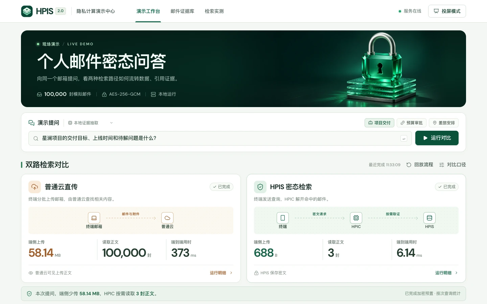

# HPIS 2.0 现场演示

[打开本机工作台](http://127.0.0.1:8769/) · [双击启动（macOS）](../启动演示.command) · [41 秒离线实录](static/media/hpis-briefing.mp4)



## 现场讲解

1. 点击右上角 **投屏模式**。保留「项目交付」或改选「预算审批」「差旅安排」，点击 **现场运行**。工作台也支持直接改写问题。
2. 第二幕显示同一问题的实际端侧上传、正文读取和总用时。默认项目问题所在的合成邮箱有 **100,000 封邮件、11,114 个附件**。普通云每次接收约 **58.14 MB** 并扫描 100,000 封邮件，预置索引的 HPIS 路径只提交一个小于 1 KB 的密封请求，HPIC 读取 **3 封**命中邮件。实际字节数和时延随本轮请求更新。点击 **回放流程** 可放慢解说节奏，数字取自已经完成的真实执行。
3. 用右方向键进入 **答案与证据**。点击上线日期旁的周衡邮件，查看会签后的《试点上线排期.csv》。讨论稿原定 12 月 8 日，最终确认的是 **12 月 15 日 20:00**。可在工作台另问「最初和最终上线时间分别是什么？」检验证据选择。
4. 如果听众关心预置成本，打开 **对比口径**。它列出本机实际建索引的总上传量和耗时，并可按本轮包体大小估算重复提问的累计流量。点 **运行明细** 可看阶段计时、密文片段和云内通信，导出本轮 JSON。**检索实测** 页给出单独测量的同核快速与严格 Top-10 基准。

投屏用左右方向键切换，Esc 退出。在全屏中可以直接从问题运行到原始邮件。离线实录为实际浏览器录屏，1600 × 900，使用本地证据抽取。[投屏画面](media/projection.webp)

## 运行和数据边界

在仓库根目录执行。macOS 启动器会打开已经运行的工作台。命令行前台方式适用于 Linux 及 H200 部署调试。

```bash
python3 -m venv .venv
.venv/bin/python -m pip install -e .
.venv/bin/python -m showcase --port 8769
```

首次启动会生成本地合成语料，使用现有 HPIS SDK 通过两跳 TLS 写入加密索引。浏览器可看到预置进度。再次启动会复用缓存，启动时重新执行一次默认问题，把实测结果带入首页。macOS 缓存在 `~/Library/Caches/hpis-showcase/`，Linux 默认在 `~/.cache/hpis-showcase/`。服务只监听 127.0.0.1。

普通云对照按 2,500 封一批实际接收整个邮箱。两路各自在独立的本地进程中执行检索和回答，使用相同问题、相同语料和相同配置的回答引擎。HPIC 在授权解密后处理命中的内容。HPIS 存储端能够观察访问模式和命中数量。浏览器的证据库呈现演示终端可以访问的合成原件。

传输量统计应用消息体，1 MB 等于 1,000,000 B。端侧上传不含事先完成的加密预置，模型端点的流量另计。本机回环值服务于本轮现场执行的比较。邮件演示使用登记字段和关键词取证，快速向量、严格向量以及不同索引部署的 10% 损耗目标均使用独立的同库明文检索对照。

## 模型接入

默认选择 **本地证据抽取**，可离线运行。Qwen 27B 与 Gemma 4 可各自配置兼容 `/v1/chat/completions` 的 H200 服务和实际 served model 名称。配置生效后，在提问框旁的引擎选择器选中对应模型。只有本轮命中的合成材料被交给所选模型。输出引用须在对应原邮件或附件中逐字核对。端点出错、生成截断或引用核对不通过时，页面显示实际回退方式。

默认部署示例采用 Qwen3.6-27B 和 Gemma 4 31B IT，权重名和地址都可改。OpenRouter 已对两个在线模型做合成 CSV 的小规模功能验证，用户 H200 的性能由目标服务器实测。[H200 启动命令与端口转发](../deployment/h200/README.md) · [应用端配置](../docs/showcase-models.md) · [原始模型测试记录](../deployment/h200/openrouter-smoke.json) · [Qwen 复核](../deployment/h200/openrouter-qwen-retest.json)

[主视觉与素材来源](ASSETS.md)
